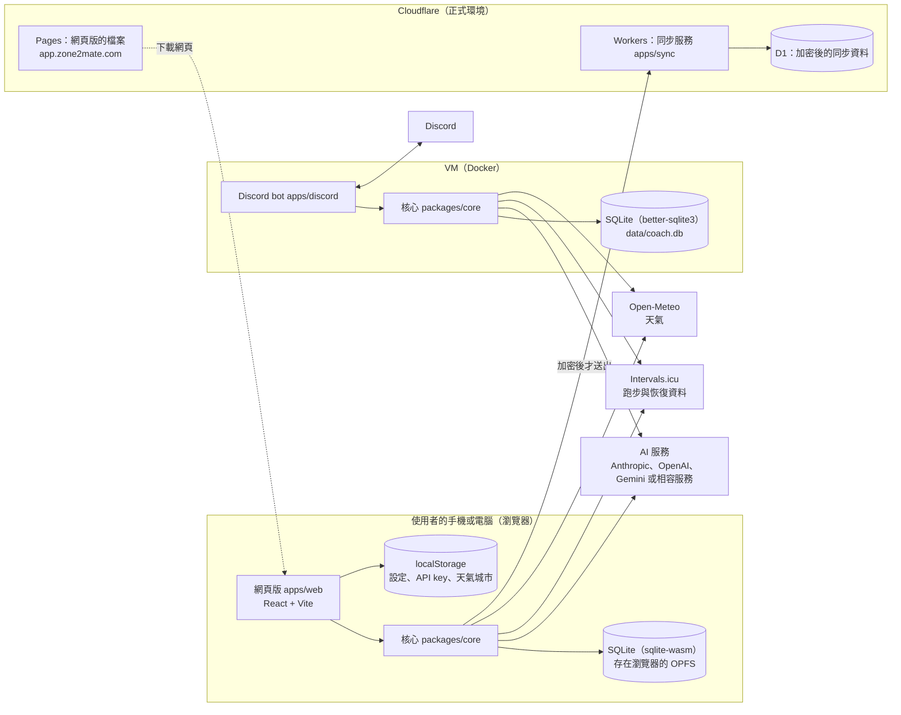
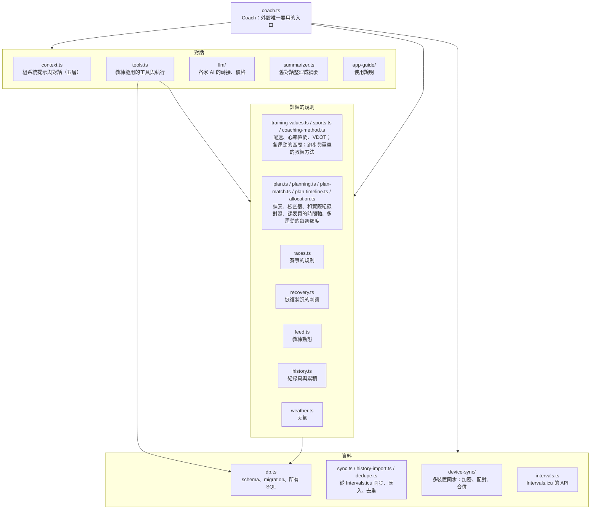
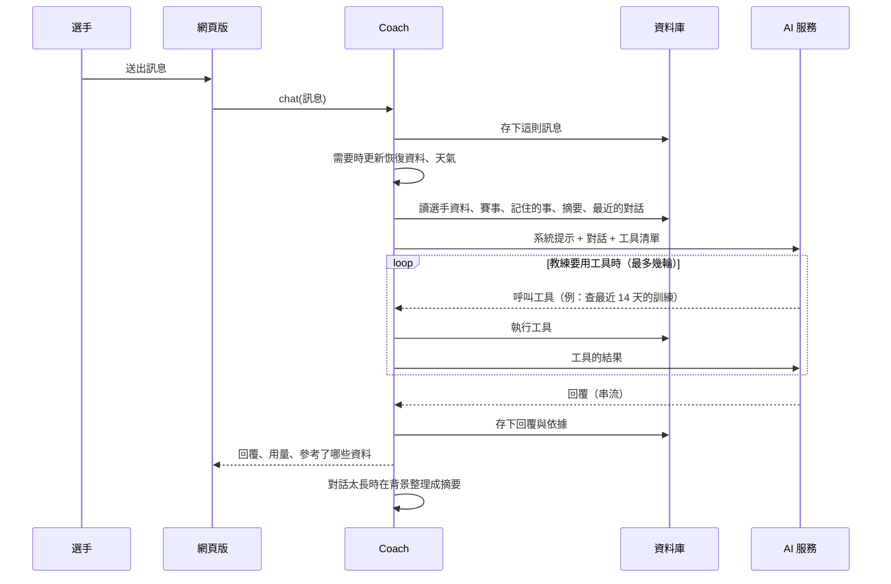
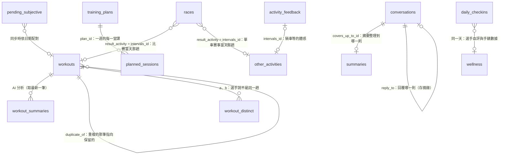
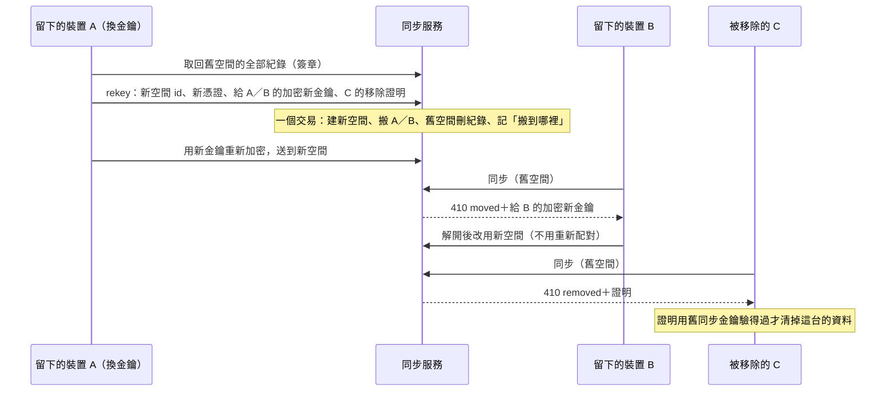

# 架構說明（v2，2026-10-24）

給想了解程式怎麼組成的人看：有哪些部分、跑在哪裡、資料存在哪裡、彼此怎麼關聯。設計的理由在規格（`running-coach-spec2_0.md`）與 KI 紀錄；這份只講「現在長什麼樣子」。程式有大改時請一起更新這份。

## 一句話

所有教練的邏輯都在一個 TypeScript 核心套件（`packages/core`）裡；網頁版和 Discord bot 只是兩個不同的「外殼」，各自提供資料庫與介面，呼叫同一個核心。資料留在使用者自己的裝置上，只有要問 AI 時才把需要的內容送給使用者選的 AI 服務。

## 全貌

- 網頁版是純前端：從 Cloudflare Pages 下載後，直接在瀏覽器裡跑核心與資料庫，瀏覽器自己去連 AI 服務、Intervals.icu、Open-Meteo。我們沒有一台「存使用者資料的伺服器」。
- 多裝置同步服務只存加密後的內容，伺服器看不到明文（12.10）。
- Discord bot 是另一份獨立的資料，和網頁版不同步。
- `apps/proxy`（訂閱模式的代理，替使用者付 AI 的費用）已經寫好，還沒有上線。
- 另外有一套 staging（`staging.zone2mate.com`）：另一個 Pages 專案、另一個 Worker 與 D1，和正式環境的網頁、同步資料完全分開，`v2` 推上去就自動更新（見下面的「部署與 CI」）。

## Repo 的組成

| 目錄 | 內容 | 程式行數（約） |
|---|---|---|
| `packages/core` | 核心：教練、對話與工具、資料庫、同步、課表、賽事、天氣……所有規則 | 10,500 |
| `packages/sqlite-node` | 給 Node 用的資料庫驅動（better-sqlite3），Discord bot、測試、模擬服務用 | 30 |
| `apps/web` | 網頁版：React 介面、瀏覽器的資料庫驅動（sqlite-wasm 跑在 Web Worker） | 6,200 |
| `apps/discord` | Discord bot：讀 `.env`、把 Discord 的訊息與指令接到核心 | 300 |
| `apps/sync` | 多裝置同步服務：Cloudflare Worker + D1（本機開發用 Node 版） | 500 |
| `apps/proxy` | 訂閱模式的代理（未上線） | 750 |
| `tools/` | 模擬上游（`mock-upstream.ts`，本機開發與實測用）、網頁實測腳本（`e2e/`）、各種本機用的小工具 | |
| `doc/` | 規格、KI 紀錄、這份架構說明 | |
| `src/` | v1 的 Python 版，觀察期結束後移除 | |

## 用到的技術

| 用途 | 技術 |
|---|---|
| 語言 | TypeScript（全部），npm workspaces 管多個套件 |
| 網頁介面 | React 19、Vite（建置）、react-markdown（顯示教練的 Markdown） |
| 資料庫 | SQLite：瀏覽器用官方的 sqlite-wasm（存在 OPFS），Node 用 better-sqlite3；兩邊共用同一份 SQL 與 schema |
| AI | 自己寫的轉接層（`packages/core/src/llm`）：Anthropic 用官方 SDK，其他走 OpenAI 相容的 Chat Completions |
| Discord | discord.js |
| 同步服務 | Cloudflare Workers + D1（SQLite） |
| 部署 | GitHub Actions：網頁版 → Cloudflare Pages；同步服務 → Cloudflare Workers；Discord bot → 建 Docker 映像放到 GHCR，再到 VM 上更新 |
| 測試 | Vitest（單元測試）、Playwright（網頁實測，接模擬上游） |

## 核心（packages/core）怎麼分

- **Coach** 是外殼唯一要用的入口：`chat()`、`sync()`、`reportRun()`、`feed()`、`activePlan()`、賽事的操作等。網頁版與 Discord 不直接碰規則。
- **規則寫在程式，不交給 AI 判斷**：課表的檢查、配速換算、恢復狀況的判讀、賽事能不能改、教練動態要提醒什麼，都是固定、可測試的程式。AI 負責聊天、解釋、在規則允許的範圍內排課。
- **教練能做的事都是「工具」**（`tools.ts`）：例如查最近的訓練、存課表、記錄比賽成績。教練說要做某件事，就是呼叫工具；工具裡再套用和網頁按鈕一樣的規則，所以選手和教練能做的事一致。

### 一則對話怎麼跑

## 資料：存在哪裡

| 資料 | 存在哪裡 | 會同步到其他裝置嗎 |
|---|---|---|
| 對話、選手資料、賽事、課表、跑步紀錄、恢復資料、記住的事…… | 資料庫（SQLite，瀏覽器的 OPFS） | 只有 App 裡才有的部分會（見下面） |
| API key、AI 的設定、Intervals.icu 的 key、時區、天氣的城市 | 瀏覽器的 localStorage（可以用密碼鎖加密 API key） | 不會 |
| 教練動態「知道了」、收起等小狀態 | localStorage | 不會 |
| 從 Intervals.icu 來的跑步、恢復資料、其他運動 | 資料庫 | 不會：每台自己去 Intervals.icu 抓 |
| 多裝置同步的雲端副本 | Cloudflare D1，加密後的內容 | 這就是同步本身 |

App 打開時呼叫 `navigator.storage.persist()`，要求瀏覽器不要在空間不足或閒置時自動清掉這些資料；設定頁的「資料」顯示瀏覽器有沒有答應（`apps/web/src/update-check.ts`，規格 12.18）。

## 資料庫的 schema（目前是第 13 版）

所有表都在 `packages/core/src/db.ts`：開頭的 `SCHEMA` 建表，`init()` 裡的 migration 依版本補欄位（舊資料庫打開時自動升級）。日期一律是使用者時區的 `YYYY-MM-DD`，時間是 ISO 字串。

（`planned_sessions` 和實際跑步、騎車的對應不存在資料庫裡，每次依日期與內容重新比對算出來。）

**選手與目標**
- `athlete_profile`：選手資料，key-value（例：`goal_long_term`、`pb_10k`、`injuries`、`pref_*` 訓練偏好、`region`）；多運動的共通設定與騎車的卡也是 `pref_*`（`pref_sports`、`pref_primary_sport`、`pref_days_per_week`、`pref_intensity_ride`、`pref_ride_hours` 等，跑步的卡沿用原本的鍵）。
- `races`：賽事。名稱、日期、距離、目標、已確認或考慮中；結局 `outcome`（完賽、沒有完賽、沒有出賽）、`outcome_reason`、個人成績 `result_time`、大會成績 `gun_time`、`result_source`、連到比賽當天跑步的 `result_activity`；`cancelled` 留給 v1 相容；賽事的運動 `sport`（`ride` 是單車的賽事，跑步是 NULL；schema 13，多運動）。
- `memories`：記住的事（選手記的或教練記的）。

**訓練紀錄**
- `workouts`：每一趟跑步。客觀數據（距離、時間、心率、配速、爬升、負荷）、選手的體感與感受、原始資料 `raw_json`；`intervals_id` 是跨裝置共通的 id；`duplicate_of` 標記重複的那筆（多個裝置上傳同一趟），`removed_at` 標記 Intervals.icu 上已刪除的。
- `workout_summaries`：教練對每一趟的分析，同一趟可能有多次（補填體感後重新分析），讀的時候取最新的。
- `workout_distinct`：選手說「不是同一趟」的兩筆，之後不再提醒或合併。
- `pending_subjective`：手錶還沒上傳時先暫存的跑後感受，同步時依日期合併進 `workouts`。
- `other_activities`：跑步以外的運動（騎車、游泳、肌力），不算跑量；同步時整批更新、跟著來源的刪除。多運動開著時，騎車也是一級的運動：配對單車的課、紀錄頁的騎車卡片、單車的檢查器規則都讀它。
- `activity_feedback`：騎車等其他運動的體感與感受（運動回報，schema 13）。`other_activities` 每次同步整批更新，回報另外存才不會被蓋掉；用 `intervals_id` 對應，那趟還沒同步到這台也先存著。
- `wellness`：手錶的恢復資料（靜息心率、HRV、睡眠），一天一筆。
- `daily_checkins`：選手每天的自評（精神、痠痛、睡眠，1–5 分）。
- `source_snapshots`：同步時存的 Intervals.icu 設定與最佳配速曲線，算訓練數值用：`run_settings`（跑步的閾值心率、區間）、`sport_settings`（各運動的設定：騎車的閾值心率、心率區間、FTP、功率區間等，只留閾值與區間，規格 12.24）、`pace_curve`。

**課表**
- `training_plans`：一週一份。舊的文字課表只有 `content`；結構化的課表另有 `week_start`、`style`（固定或彈性）、`reason`、`outline`（之後幾週的大綱）、`notes`（檢查器的提醒與教練的理由）。`is_active` 標記還在用的。
- `planned_sessions`：結構化課表的每一堂課：日期、種類、標題、步驟（JSON，目標寫代號，顯示時才換算成配速）、目的、完成的標準、替代的課、狀態（照原本、跳過、改用替代）；交叉訓練的運動 `sport`（ride、swim、other，心率與功率的目標用那項運動的設定換算；單車的課 `ride_*` 一律是 ride）、選手回報做完了的時間 `done_at`（肌力等沒有手錶紀錄的課）（schema 12，規格 12.24）。

**對話**
- `conversations`：每則訊息（角色、內容、時間），加上教練回覆的依據 `sources`、回覆的引用 `reply_to`、是否已整理進摘要 `archived`。
- `summaries`：舊對話整理成的摘要，教練每次對話時帶入最新的一份。

**多裝置同步的記帳**（不同步本身）
- `sync_state`：上次同步時每一筆的雜湊、伺服器序號與版本號，用來判斷哪些要送出、拒絕被倒回的舊版本。
- `sync_pending`：別台傳來、但這台還沒有對應紀錄的（例如那趟跑步還沒從 Intervals.icu 抓到）。
- `sync_meta`：同步空間的 id 等設定。換金鑰（規格 12.27）時清掉 `sync_state` 與 `sync_meta`、留著 `sync_pending`，在新的空間重新開始。

## 多裝置同步的資料

只同步「只存在 App 裡的資料」；從 Intervals.icu 來的每台自己抓。每一筆在各裝置上要有共通的名字（`packages/core/src/device-sync/entities.ts`）：

| 名字 | 內容 |
|---|---|
| `p:欄位名` | 選手資料的一個欄位 |
| `r:sync_id` | 一場賽事 |
| `pl:sync_id`、`ps:sync_id` | 一份課表、一堂課 |
| `ck:日期` | 一天的自評 |
| `m:sync_id` | 一則記住的事 |
| `c:內容雜湊`、`cs:內容雜湊` | 一則對話、一份對話摘要 |
| `w:跑步 id`、`ws:跑步 id`、`wd:兩筆跑步 id` | 某一趟跑步上的體感、教練的分析、「不是同一趟」 |
| `af:活動 id` | 騎車等其他運動的體感與感受（schema 13；舊版不認得，不套用也不刪） |

每一筆用同步金鑰加密後才送出（AES-GCM）。伺服器的 D1：
- `spaces`：同步空間與存取憑證的雜湊。
- `records`：加密後的每一筆與序號。
- `pair_slots`：配對新裝置時的暫存，幾分鐘後過期。
- 裝置（規格 12.27，功能開關 `devices`）：
  - `space_modes`：哪些空間是裝置模式、從什麼時候開始。
  - `devices`：每台的公開金鑰、加密的名稱、加入與最後同步的時間、移除的時間與證明、換金鑰後給它的新金鑰。
  - `moves`：換過金鑰的空間搬到哪個新空間。
  - `sig_nonces`：簽章用過的一次性亂數，十分鐘後過期。

**裝置與換金鑰**（規格 12.27，`device-sync/device.ts`；網頁版在功能開關 `devices` 後面）

- 每台有自己的簽章與收件金鑰（P-256，私鑰不可匯出，網頁版存在 IndexedDB `zone2mate-device`）。每個請求簽方法、路徑、時間、一次性亂數與內容的雜湊；伺服器檢查時間在前後 5 分鐘內、亂數沒用過。
- 登記：同步金鑰導出的舊憑證，加上這台的簽章。空間一旦有裝置登記（裝置模式），舊憑證只能用來登記，不能讀寫；沒有登記過的空間照舊（舊版的用戶端）。
- 冷卻期由伺服器執行：加入未滿 24 小時的不能換金鑰、刪除雲端資料。既有空間升級後 3 天內登記的算「升級前就在同步」，不受限制（一樣會提醒其他裝置）。
- 伺服器假造不出：裝置的名稱與公開金鑰（以同步金鑰加密並綁定）、給每台的新金鑰（混了舊同步金鑰導出的值）、移除的證明（舊同步金鑰的 HMAC）。

## 部署與 CI

| 觸發 | 做什麼 |
|---|---|
| 推到 `v2` | CI（`v2-ci.yml`）：型別檢查、測試、建置、建 Discord 映像。網頁版、同步服務或核心有改時另外部署 **staging**（`staging.yml`）：staging 的同步服務（Worker `running-coach-sync-staging` 與它的 D1）與網頁版（另一個 Pages 專案，正式分支是 `v2`，`staging.zone2mate.com`） |
| 合併到 `main` | **正式環境**：網頁版或核心有改：部署到 Cloudflare Pages（`web.yml`，`app.zone2mate.com`）；同步服務有改：部署 Worker（`sync.yml`）；bot 用到的檔案有改：建映像並更新 VM 上的 bot（`deploy.yml`）；依版號打標籤（`tag-release.yml`） |

流程：開發 session 推 `v2` → staging 自動更新 → 使用者在 staging 實際試 → 說「合併部署」→ 正式環境。Discord bot 沒有 staging（只有使用者自己用）。

兩個環境怎麼分（規格 12.19）：
- 網址、Pages 專案、D1 的 id 都在 repo 的 Variables（正式：`WEB_PAGES_PROJECT`、`WEB_URL`、`SYNC_URL`、`SYNC_D1_DATABASE_ID`；staging：前面加 `STAGING_`），不寫進 repo。沒設定 staging 的 Variables 時，`staging.yml` 整個跳過、不失敗。
- 同步服務允許的網頁來源在部署時由 `tools/sync-config.ts` 填進 `wrangler.toml`：正式的是 `WEB_URL`（搬家期間加上 `OLD_WEB_URL`），staging 的只有 `STAGING_WEB_URL`；不是 https 或一個都沒有時部署失敗，上一次的設定照舊。
- 功能開關（規格 12.25，`packages/core/src/features.ts`）：建置時決定哪些功能開著。網頁版讀 `VITE_FEATURES`（逗號分隔或 `all`）；staging 的建置不論設定都全開；正式版由 Variables 的 `WEB_FEATURES` 決定，沒設定時全關。開著的功能放進 `CoachSettings.features`，核心用 `featureOn()` 判斷（例：`multisport` 開著時教練方法是 v5、選手練騎車時加上單車的教練方法與單車的課、工具多了交叉訓練的 `sport` 與 `save_activity_feedback`、教練的角色是耐力運動教練、教練動態會問課表外的運動要不要調整）；設定頁最下面列出開著的。`testmode`（測試模式）只在 staging 與開發用的建置開著，正式版沒有。Discord bot 讀 `.env` 的 `FEATURES`（預設全關）。關著時 App 與教練的行為和沒有那個功能時一樣；資料庫只做向下相容的新增，不擋在開關後面。
- 建置的差別：staging 建置時有 `VITE_STAGING=1`（標題列與每一頁上方標示 Staging，`_headers` 加 `X-Robots-Tag: noindex`），`VITE_SYNC_URL` 指向 staging 的同步服務。正式版建置時有 `VITE_WEB_URL`（正式的網址）：同一份建置也在舊網址 `running-coach-bgb.pages.dev` 上，從正式網址以外的地方打開時，每一頁上方與設定的最上面顯示搬家的提示（`views/Moved.tsx`）。

版號只有一個來源：repo 根目錄 `package.json` 的 `version`。網頁版建置時讀它（標題列只顯示 Beta，設定頁最下面是完整的版號、commit 與建置日期），Discord bot 建置時由 esbuild 打包進去（`/status` 顯示）。改版號用 `npm run version:bump -- minor|patch`，一次改好各套件的 `package.json` 與 lockfile；每次合併部署發一版，在 `main` 的合併 commit 打 `vX.Y.Z` 標籤（`CLAUDE.md`、規格 12.19）。

網頁版的建置另外輸出隱私說明頁 `privacy.html`（Cloudflare Pages 提供在 `/privacy`）：不用 JavaScript 的靜態頁，範本在 `apps/web/privacy/`，建置時填入 staging 的標示與同步服務的網址；測試會檢查網頁版預設會連的外部網址都寫在上面（規格 12.20）。資料流向（存在哪裡、送到哪裡）改了時要一起改這一頁。

網頁版的建置另外輸出 `version.json`（這次建置的 commit 與日期，`_headers` 設成不快取）。網頁打開時、回到前景時、前景中每 30 分鐘讀一次，和自己的 commit 不同就在上方提示「有新版本，點這裡更新」，點了才重新載入；讀不到時不提示（規格 12.18）。

開發一律在 `v2`（推上去只更新 staging），合併到 `main` 就是上線，所以只在使用者說「合併部署」時合併（`CLAUDE.md`）。

## 測試

- 單元測試：`npm test`（Vitest），主要在 `packages/core/test`，用記憶體裡的 SQLite 與假的 AI 回應（照腳本回覆、可以呼叫工具）。
- 網頁實測：`tools/e2e/`，用 Playwright 照使用者的操作點一遍，接模擬上游（假的 AI、Intervals.icu、同步服務、Open-Meteo），不需要任何金鑰。做法見 `tools/e2e/README.md`。
